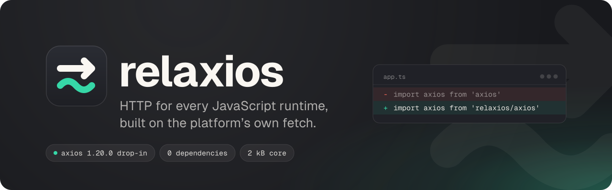

<p align="center">
  
</p>

# relaxios

HTTP for every JavaScript runtime, built on the platform's own `fetch`, Web Streams and
`AbortController`. No runtime dependencies, ESM first, TypeScript strict.

| Entry | What it is | Docs |
| --- | --- | --- |
| `relaxios/axios` | A drop-in replacement for axios 1.20.0 with the same API, types and behavior, checked against real axios in every runtime, with no dependencies. | [docs/axios.md](docs/axios.md) |
| `relaxios` | A 2 kB client with the familiar shape (`get`, `post`, `create`, `defaults`, interceptors, `timeout`, `signal`) and fetch-native responses. | [docs/core.md](docs/core.md) |
| `relaxios/progress` | Download and upload progress for `fetch`. A `TransformStream`, an event reducer with rate and time remaining, and an XHR-backed `fetch` for upload byte counts. | [docs/progress.md](docs/progress.md) |
| `relaxios/upload` | Resumable chunked uploads over resumable uploads for HTTP (draft -12), S3 multipart or a single XHR request, with pause, resume, retries and server-confirmed progress. | [docs/upload.md](docs/upload.md) |

Each entry is a separate build, and an app that imports only `relaxios/axios` ships only the port.

## Install

```sh
npm install relaxios
```

Runs on Node 20.3+, Bun, Deno, Cloudflare Workers and browsers from the last two years. Types are
included.

## Why relaxios instead of axios

- **One package instead of 27.** axios 1.20.0 depends on follow-redirects, form-data,
  proxy-from-env and https-proxy-agent, and installing it adds 27 packages. relaxios has no
  dependencies; that behavior is reimplemented inside it. Fewer packages means less to audit and
  fewer supply-chain updates to chase.
- **The same behavior, checked on every change.** A differential suite runs 445 cases against
  real axios 1.20.0 and against relaxios in Node, Bun, Deno, Node with jsdom, Chromium, Firefox,
  WebKit and Cloudflare's workerd, with every adapter value, and requires 0 differences in
  status, headers, `data`, `request`, error codes and messages. axios's own `tests/unit` and
  `tests/browser` suites and axios-mock-adapter's suite also pass with no skipped tests. See
  [docs/testing.md](docs/testing.md).
- **TypeScript source.** The port is typed file by file, and the exported types are the axios
  type names.
- **More in the same package when you need it.** Stream progress, resumable uploads with
  server-confirmed progress, and a 2 kB fetch client for new code, each in its own entry, so
  you only ship what you import.

Trade-offs: the browser build is 22.73 kB min+gzip against 18.8 kB for axios, because it
carries an `XMLHttpRequest` stand-in so browsers can use `fetch` with axios-identical responses.
The port follows the axios 1.20.0 API; features added in later axios releases arrive when the
port is updated.

## Switching from axios

1. Install relaxios and remove axios:

   ```sh
   npm install relaxios
   ```

   ```sh
   npm uninstall axios
   ```

2. Change the import. Everything else stays the same: the default instance, `create`,
   interceptors, `AxiosError`, `CancelToken`, `AxiosHeaders`, the config and the types.

   ```ts
   import axios, { AxiosError, isAxiosError, type AxiosInstance } from 'relaxios/axios';
   ```

   With CommonJS, `require('relaxios/axios')` returns the callable default instance, as
   `require('axios')` does.

3. If a dependency imports `axios` itself (axios-mock-adapter, axios-retry, generated API
   SDKs), alias `axios` so every import gets relaxios. The same alias lets you keep
   `from 'axios'` in your own code.

   Vite and Vitest (`vite.config.ts`):

   ```ts
   resolve: { alias: [{ find: /^axios$/, replacement: 'relaxios/axios' }] }
   ```

   webpack:

   ```js
   resolve: { alias: { axios$: 'relaxios/axios' } }
   ```

   Jest:

   ```js
   moduleNameMapper: { '^axios$': 'relaxios/axios' }
   ```

   TypeScript, when imports keep saying `axios` (`tsconfig.json`):

   ```json
   "paths": { "axios": ["./node_modules/relaxios/dist/axios.node.d.ts"] }
   ```

   Plain Node without a bundler has no alias, so those dependencies load the real axios
   package. Keep axios installed for them in that case.

How the port is put together (adapters, the `fetch` transport with its `XMLHttpRequest`
stand-in, builds, runtimes) is in [docs/axios.md](docs/axios.md).

## Core client

```ts
import http, { HttpError } from 'relaxios';

const api = http.create({ baseURL: '/api', timeout: 20_000 });
api.interceptors.request.use((config) => ({ ...config, headers: { ...config.headers, 'x-trace': id() } }));

try {
  const { data, headers } = await api.get<User>('/me', { params: { ids: [1, 2] }, signal });
} catch (e) {
  if (e instanceof HttpError && e.code === 'ERR_BAD_REQUEST') console.log(e.status, e.response?.data);
}
```

The core client keeps the shape of axios and the primitives of `fetch`. `headers` is a `Headers`
instance, `request` is the `RequestInit` that was sent, `responseType: 'stream'` returns the
body `ReadableStream`, and `fetchOptions` passes anything through to `fetch`. Reference in
[docs/core.md](docs/core.md).

## Progress

```ts
import { progress, trackResponse } from 'relaxios/progress';

const res = await fetch('/big.bin');
const body = res.body!.pipeThrough(progress((e) => render(e.ratio), res));
```

Events carry `loaded`, `total`, `ratio`, `rate` (bytes/s), `estimated` (seconds left),
`lengthComputable` and `bytes`. Events are throttled to animation frames in visible pages and to
100 ms elsewhere. For upload counts in browsers, `xhrFetch({ onUpload })` is a fetch-compatible
function backed by `XMLHttpRequest`. Reference in [docs/progress.md](docs/progress.md).

## Resumable uploads

```ts
import { upload, ietf } from 'relaxios/upload';

const job = upload(file, { protocol: ietf({ endpoint: '/uploads' }), chunkSize: 1 << 20 });
for await (const p of job.progress) render(p.confirmed / p.total);
const { status, data } = await job;
```

`confirmed` counts bytes the server acknowledged, and `estimated` is smoothed from the measured
rate but never passes `confirmed` plus the chunk in flight. Jobs pause and resume, retry with
backoff, continue from the server's offset after errors, survive page reloads with a resume
store, and cancel on the server on `abort()`. Protocols are `ietf()`
(draft-ietf-httpbis-resumable-upload-12), `s3Multipart()` (presigned parts), `xhrSingle()` (one
request), or your own. Reference, server setup, CORS rules and the draft -12 notes are in
[docs/upload.md](docs/upload.md).

## Sizes

min+gzip, measured by `npm run size` (size-limit with rolldown). "Own code" excludes the other
relaxios entries a module imports.

| Entry | Size | Budget |
| --- | ---: | ---: |
| `relaxios` (core client) | 1.91 kB | 3 kB |
| `relaxios/axios`, browser build | 22.73 kB | 23 kB |
| `relaxios/axios`, Node build (Node built-ins external) | 39.12 kB | none |
| `relaxios/progress` (all exports) | 1.31 kB | 1.5 kB |
| `relaxios/upload` core (`upload()`) | 1.46 kB | 3 kB |
| `ietf()` added to the upload core | 1.45 kB | 1.5 kB |
| `s3Multipart()` added to the upload core | 0.83 kB | 1.5 kB |
| `xhrSingle()` added to the upload core (plus `xhrFetch`) | 0.48 kB | 1.5 kB |
| upload with every protocol and progress | 4.50 kB | |

The axios 1.20.0 browser build measures 18.8 kB the same way. The port carries the same code
plus the `XMLHttpRequest` stand-in and the fetch transport for the xhr profile.

## Runtimes

| Runtime | `relaxios/axios` transport | Notes |
| --- | --- | --- |
| Chrome, Firefox, Safari (last two years) | `fetch` with the XHR stand-in, or a real `XMLHttpRequest` on request | Browsers without Web Streams are out of scope. |
| Node 20.3+ | `node:http`, `node:https`, `node:http2` | `AbortSignal.any` needs 20.3. |
| Bun, Deno | `node:http` | Same http profile as axios. |
| Cloudflare Workers, other edge runtimes | `fetch` | Do not set `credentials` or `withCredentials`. |
| jsdom, happy-dom | real `XMLHttpRequest` | The mock XHR is used, as with axios. |
| React Native | browser build | Same as axios's `react-native` condition. |

## Development

```sh
npm install
npm run build                 # tsdown -> dist/
npm run typecheck
npm test                      # unit tests, upload servers, differential suite in Node, jsdom, Bun, Deno and workerd
npm run test:e2e              # Playwright. progress, XSRF, uploads and the differential suite in Chromium, Firefox and WebKit
npm run test:axios-suite      # axios 1.20.0's tests/unit against the port (browsers: npm --prefix test/axios run test:browser)
npm --prefix test/mock-adapter test   # axios-mock-adapter 2.1.0's suite against the build
npm run size                  # size table and budgets
node scripts/smoke.mjs        # also: bun scripts/smoke.mjs, deno run -A scripts/smoke.mjs
```

The toolchain needs Node 22.12+. The differential suite needs `bun` and `deno` on the PATH (or
`BUN` / `DENO` set) and `npx playwright install --with-deps` for the browser runs. Layout,
environment variables and how to add a differential case are in [docs/testing.md](docs/testing.md).

Releases are automatic. Conventional commit titles on `main` pick the next semver version, and
the Release workflow tags it and publishes to npm (`beta` and `alpha` branches publish
prereleases). See [CONTRIBUTING.md](CONTRIBUTING.md).

## License

MIT. `relaxios/axios` is a port of axios 1.20.0 (MIT), see [NOTICE](NOTICE).
